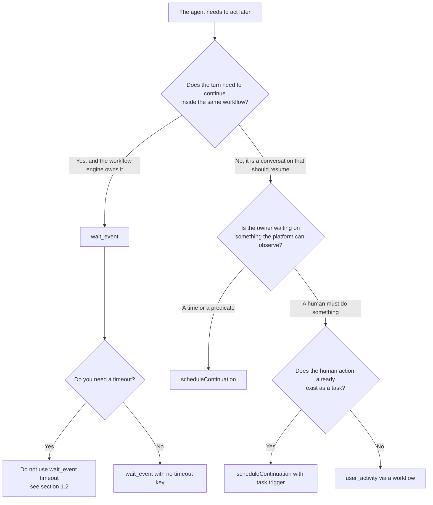

# Durable agent continuations

A **continuation** is a durable, owned wait. An agent registers one when it wants to
say *"I will follow up when PR 482 merges, or at 14:00 at the latest"* and have that
sentence be true even if the process restarts, the browser closes or the turn ends.

It is two things kept in step:

| | |
|---|---|
| **The record** | a row in `reactor_continuations` — the queryable index (`models/AgentContinuation.ts`) |
| **The waiter** | a workflow instance of `reactor.AgentContinuation@1.0.0`, parked on `wait_event` — the durable suspension |

The record is what makes the promise **checkable**; the instance is what makes it
**keepable**. They are reconciled by `continuationId`. A sweeper
(`reactor.AgentContinuationSweeper@1.0.0`, cron `* * * * *`) claims due records and
publishes the wake event. Nothing in this design impersonates a user at fire time:
the instance was started *at registration* with the owner's identity, so the wake
turn is sent as the owner structurally, not by `runAs`.

---

## 1. Which primitive should I use?

There are three ways to wait. They are not interchangeable, and choosing wrong is how
an agent ends up making an unbacked promise.



### 1.1 `scheduleContinuation` — the default for agents

Use it whenever the **conversation** must resume: a chat turn ends, the condition may
not become true for minutes/hours/days, and the agent must speak again in the same
session. It is the only primitive that:

- survives a server restart (the record and the instance are both persisted);
- has a deadline, so it cannot wait forever;
- reports **not observed** honestly when the deadline passes;
- is visible to the user (`ReactorPendingContinuations`, `todo(list)`) and to an
  administrator, without reading raw Mongo.

```ts
@scheduleContinuation({
  at: "2026-10-23T16:00:00Z",
  reason: "PR #482 merge",
  resumePrompt: "Check whether PR #482 merged and report the result.",
  expirePrompt:
    "The wait for PR #482 expired without the merge being observed. Say plainly that it was not observed and what you can check now. Do not report it as merged.",
})
```

Exactly one trigger: `at` (ISO date-time or epoch ms), `eventName`, `condition`, or
`task`. `at` and `condition` are evaluated by the sweeper; `eventName`/`task` are
accepted for compatibility but **nothing in this deployment publishes them yet**, so
such a wait can only expire. Say so to the user rather than implying it is watched.

### 1.2 `wait_event` — only inside a workflow you control

`wait_event` is the engine's native suspension and is the correct choice when a
workflow (not a conversation) must pause and you can publish the event yourself from
inside the same workflow family: approvals, fan-out/join, a YAML step sequence.

**Do not pass `timeout` to `wait_event`.** In this engine `timeout` does not expire
the wait; it makes the subscription *deaf* for that long and then waits forever. A
timeout therefore silently discards signals and never wakes. A continuation uses
`wait_event` **without** a timeout and delivers expiry as a sentinel event from the
sweeper — that is the pattern to copy if you need a deadline.

### 1.3 `user_activity` — when a human must act

`user_activity` creates a task and parks the workflow until the task is completed. It
is right for approvals and data entry where a **task is the product**. It is not a
scheduler: it has no deadline of its own, and it does not resume a chat session.

If the conversation must resume after a human action that already exists as a task,
prefer `scheduleContinuation` with a `task` trigger — the continuation owns the chat
turn and the task stays the human's surface.

---

## 2. `resumePrompt` and `expirePrompt`

These two strings are the entire honesty mechanism. They are the turns the agent
receives when the wait ends, and the difference between them is the difference
between a result and a non-result.

| | `resumePrompt` | `expirePrompt` |
|---|---|---|
| When sent | the signal **was observed** (time reached, condition satisfied, event arrived, task completed) | the deadline passed and the signal **was not observed** |
| Required | yes | **yes — the macro refuses without it** |
| What it must say | what to do with the new fact | that the signal was *not* observed, and what can be checked instead |
| Failure if vague | the agent reports a result it has | the agent reports an expiry as if it were a result |

`expirePrompt` is required on purpose. An implementation where expiry is silent or
generic is exactly the "better-hidden promise" this feature exists to remove.

The record also distinguishes *why* it ended without delivery, so a reader can tell
an outage from a negative result:

| `firedBy` / event reason | Meaning |
|---|---|
| `signal` / `condition_satisfied` | the awaited signal was observed |
| `time_reached` | an `at` wait fired on time — observed |
| `deadline_passed` | the deadline passed with no signal — **not observed** |
| `time_passed_unswept` | the moment arrived while the sweeper was down; nothing watched it — **not observed, and not a verdict on the signal** |
| `wake_published_not_delivered` | the wake was published but could not be delivered to the session |

The last two exist so an infrastructure gap is never read as "the thing you were
waiting for did not happen".

---

## 3. Reading `ReactorPendingContinuations`

```graphql
query {
  ReactorPendingContinuations(chatSessionId: "507f…", includeTerminal: false, limit: 20) {
    continuationId
    reason
    state
    fireAt
    firedAt
    outcome
    chatSessionId
    personaId
    createdAt
  }
}
```

- **Scoped to the caller.** The service filters on `ownerUserId === context.user._id`.
  `userId` is an administrators-only affordance; a non-admin asking for somebody
  else's id is **refused with an error**, never narrowed to an empty list. An empty
  list would make a scoping bug look like "you are waiting on nothing".
- **Active by default.** `state` is one of `pending`, `armed`, `firing`. Pass
  `includeTerminal: true` to see `fired`, `expired`, `cancelled`, `orphaned`,
  `failed` and read `outcome` (`observed` / `not_observed`).
- **`correlationKey` is never returned.** It is 32 random bytes that authorise a
  wake, so it is a credential, not data. `toPublicView()` drops it, and the resolver
  re-projects into the nine declared fields. Both reductions are tested; neither is
  allowed to be the only one.
- A missing continuation service **throws** rather than returning `[]`: "nothing
  pending" and "the service that knows is absent" must not look the same.

The same records are rendered read-only by `todo(action="list")`:

```
⏳ waiting on PR 482 merge until 14:00 (continuation 6f3a…)
```

Those entries are a **rendering**, never an insertion: they are not written into
`state.vars['reactor.todos']`, so `todo(update|assign|remove)` cannot reach them, and
those actions explicitly refuse the `continuation:` prefix and name
`cancelContinuation`. `todo(dueAt=…)` is **rejected** and points at
`scheduleContinuation` — a todo with a date is only a note, and nothing will fire.

---

## 4. When a wait ends without a result

`expired`, `orphaned` and `failed` are **never silent**. The owner is notified through
two channels, in this order:

1. **Task surface — always.** A task is written to `reactory_tasks`
   (`category: agent-continuation`, `workflowStatus: attention_required`) with the
   `reason` and the explicit statement that **the signal was not observed**. This is
   the surface `userTasks` and `user_activity` already use, and it is the only
   channel that works today.
2. **Communicator — best effort.** `communicator.CommunicatorService@1.0.0.send` is
   attempted when an owner email is present. Its provider wiring is being repaired by
   a parallel programme, so a throw or a declined send is recorded
   (`notificationError`) and never suppresses the task.

The chosen channel is persisted on the record as `notificationChannel`
(`task`, `communicator`, `communicator+task`, or `none`) together with `notifiedAt`.
`none` means both channels failed and is logged at error level — at that point the
log is the only remaining evidence, and it says so.

**Decision recorded:** because the communicator's public send path is not functional
end-to-end in this deployment, the task surface is the guaranteed channel and the
communicator is optional. This is a deliberate compromise, not an oversight: an
optional channel must never be the *only* evidence.

---

## 5. Caps, costs and limits

| Limit | Value | Where |
|---|---|---|
| Pending continuations per chat session | **3** (`MAX_PENDING_PER_SESSION`) | `AgentContinuationService.register` |
| Minimum gap between two wake turns on one session | **60 s** (`MIN_INTERVAL_MS`) | same |
| Deadline bounds | **5 s – 30 days** (`MIN_TTL_MS` / `MAX_TTL_MS`) | same |
| Default deadline | `at` + 15 min, otherwise 24 h | `scheduleContinuation` macro |
| Sweeper cadence | every minute (`* * * * *`) | `AgentContinuationSweeper` schedule |
| Delivery attempts | `maxAttempts`, default 2 | record |
| Republish window | 180 s (`DEFAULT_REPUBLISH_AFTER_MS`) | sweeper |
| Stale `firing` | 120 s (`DEFAULT_STALE_FIRING_MS`) before assumed crashed | sweeper |
| Condition triggers | **allowlist, empty by default** | `registerConditionPredicate` |

**Cost.** A waiting continuation costs one small Mongo document for the record and
one parked workflow instance. A parked instance consumes no CPU and no model tokens:
the cost is storage and one `wait_event` subscription. The *billable* event is the
wake turn — a normal AI turn, subject to the user's budget. That is why registration
refuses when the budget is exhausted (`over_budget`): parking a wait whose wake turn
could never be answered would be another unbacked promise.

**Condition triggers are refused by default.** A `condition` names a service method
and the sweeper evaluates it, so without a policy a prompt-injected model could call
an arbitrary method with system privileges once per tick for up to 30 days. The
allowlist is empty unless the feature that owns the predicate registers it, and
evaluation runs as the **record owner**, not the sweeper. An unlisted pair is
refused with a message that points at `at`.

---

## 6. Verifying the surface

```bash
cd /Users/wernerw/Projects/reactory/reactory-express-server
npx --no-install jest --config jest.config.ts --runInBand \
  --testPathPattern "ai-reactory-<worktree>/"
```

The continuation suites and what they pin:

| Suite | Pins |
|---|---|
| `services/reactor/__tests__/AgentContinuationService.test.ts` | register/deliver/fire semantics, owner attribution, caps, `list()` never leaks the key |
| `services/reactor/__tests__/AgentContinuationNotification.test.ts` | `expired` / `orphaned` / `failed` each notify; task always, communicator optional; idempotency |
| `graphql/resolvers/__tests__/ReactorContinuation.test.ts` | type has exactly nine fields; **no `correlationKey`** in type or serialised result; caller scoping and admin refusal |
| `ai/macro/runtime/__tests__/todoContinuationProjection.test.ts` | `todo(list)` projection is read-only; `update`/`assign`/`remove` refuse; `dueAt` rejected naming `scheduleContinuation` |
| `ai/macro/runtime/__tests__/continuationMacro.test.ts` | macro refusals and the honesty instructions |
| `workflow/__tests__/AgentContinuation.contract.test.ts` | the YAML workflow contract with the service |

Manual check that a real record is observable:

1. Ask an agent to `@scheduleContinuation` with `at` about two minutes out.
2. `ReactorPendingContinuations` returns the record in state `armed`.
3. `todo(action="list")` shows the `⏳ waiting on …` line and nothing is added to the
   todo lists.
4. Let the deadline pass without any signal: the state becomes `expired`,
   `outcome` is `not_observed`, and a task appears in the owner's task list quoting
   the `reason` and stating the signal was not observed.
